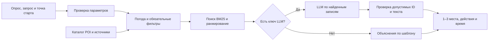

# Seruen: устройство сайта и задачи владельца

> Обновление 20.10.2026: подключены Groq, Geoapify и GraphHopper с общими лимитами D1; карта открывается сразу, каталог расширен до 65 мест. Актуальное состояние и условия домена `.kz`: [connected-services.md](connected-services.md). Ниже — предыдущий снимок архитектуры от 19.10.2026.

Состояние на 19 октября 2026 года. Рабочий сайт: https://seruen-astana.connect550439.chatgpt.site . Это прототип первой задачи хакатона, с работающим интерфейсом и внешними источниками, но с ограниченным покрытием данных.

## Из чего состоит приложение

**Интерфейс** написан на React 19 и TypeScript. Vinext предоставляет маршруты приложения и серверные обработчики, Vite собирает проект. CSS и CSS Modules отвечают за адаптивность, тему и анимации. Интерфейс поддерживает русский, казахский и английский. Тексты внешних публикаций могут сохранять язык источника. Переводы интерфейса и описаний POI подготовлены в коде; переводчик LLM при каждом открытии страницы не вызывается.

**Сервер** работает в Cloudflare Workers через Sites. Он проверяет запросы, читает каталог, обращается к погоде и афише, кеширует ответы и формирует рекомендации. Публикация новой версии включает проверку TypeScript, тесты, сборку, сохранение исходников и развертывание. Просто изменение файла на компьютере еще не меняет публичный сайт.

**Данные мест** — JSON-снимок в репозитории: 53 POI, 37 локальных фотографий; для 16 мест показана подписанная иллюстрация. В записях есть координаты, описание, теги, тип пространства, длительность визита и источники. Отсутствующие рейтинги, часы и цены остаются неизвестными. Координата здания не считается подтвержденным входом. Известная цена и ее источник используются отдельно от редакционной оценки самостоятельного внешнего осмотра.

**Постоянная база пользователей пока не подключена.** В `.openai/hosting.json` привязки D1 и R2 равны `null`. Язык, тема, ответы опроса и ID избранных мест хранятся в localStorage конкретного браузера. Аккаунта, синхронизации между телефонами, бронирований и оплаты внутри Seruen нет.

## Как формируется рекомендация

1. Посетитель выбирает настроение, размер компании, помещение/улицу, бюджет и желание поесть. Можно указать свободный запрос, время и стартовый ориентир либо добровольно использовать геолокацию.
2. Сервер отсеивает неподходящие места по погоде, пространству, времени и другим ограничениям. Для неизвестной цены он не придумывает доступность в бюджете.
3. Поиск BM25 сопоставляет слова запроса с описаниями и тегами. Балл дополняют близость, настроение и предпочтения. Это лексический поиск; векторная БД и embeddings сейчас не используются.
4. Кандидаты превращаются в 1–3 альтернативы. Это отдельные варианты посещения, а не оптимизированный маршрут через все точки.
5. При `OPENAI_API_KEY` сервер может попросить LLM написать объяснения и идеи действий только по найденным ID. Ответ модели проверяется; при ошибке применяется шаблон. Названия, координаты, цены и другие факты выводятся из данных, а не доверяются свободной генерации.

**На момент проверки в окружении хостинга настроен только `YANDEX_MAPS_JS_API_KEY`. Ключ LLM отсутствует.** Сейчас публичный подбор использует поиск, правила и шаблоны. Подключенная карта не означает, что подключена языковая модель. Для полноценной генеративной части RAG нужно настроить LLM, бюджет, защиту от злоупотреблений и оценить качество ответов.

## Что происходит автоматически

| Часть | Поведение при работе сайта | Ограничение |
| --- | --- | --- |
| Мини-опрос и персонализация | Профиль применяется к рекомендациям и бюджетному фильтру афиши | Предпочтения привязаны к браузеру |
| Погода | Самостоятельный запрос, обновление раз в 10 минут; Open-Meteo, затем MET Norway | Это модельные данные/почасовой прогноз. При сбое градусы скрываются. MET не предоставляет «ощущается» в используемом ответе |
| Кино | Сервер читает разрешенные публичные страницы Киноафиши; интерфейс запрашивает обновление каждые 2 минуты | До 6 фильмов, неполная афиша; сюжет есть не у всех публикаций. Цена часто «от», наличие билетов проверяется у продавца |
| Городские события | Чтение публичной афиши Astana.kz и проверка сегодняшней даты по времени Астаны | Пока ограниченный набор подтвержденных площадок. Пустой раздел не означает, что в городе нет событий |
| Карта | После согласия загружается Яндекс, свои маркеры, управление и пробки; предусмотрены резервные карты | Число пробок показывается только при свежем значении провайдера; может быть недоступно |
| Дата и актуальность | Проверяются дата события, время начала, возраст источника и погоды | Время нашей загрузки не равно времени обновления издателем |
| Избранное, язык, тема | Сохраняются и восстанавливаются в браузере | Нет облачной синхронизации |
| Фото дня | При подключенном разрешенном фиде проверяются права, авторство и сегодняшняя дата съемки | Фид не подключен; сейчас показано архивное фото с подписью |

Обновление афиши работает через запросы посетителей. Отдельный круглосуточный сборщик новостей и фоновое расписание заданий сейчас не запущены. Изменение верстки источника может нарушить публичный адаптер, поэтому нужны наблюдение и обслуживание.

Скрипты `collect-poi.mjs`, `collect-landmarks.mjs`, `collect-photos.mjs` автоматизируют получение координат и материалов **после запуска команды**. Расписание их запуска не настроено. Описания, соответствие фотографий и спорные записи проверяет редактор. Обновленный каталог нужно проверить, собрать и опубликовать.

## Какие API из картинки полезны

| Продукт Яндекса | Польза для Seruen | Приоритет |
| --- | --- | --- |
| JavaScript API | Уже используется для интерактивной веб-карты, маркеров и пробок | Сохранить текущее подключение |
| Получение деталей маршрута | Настоящий пешеходный путь и время между стартом и выбранным местом | Наиболее полезное следующее развитие, после проверки покрытия Астаны и тарифа |
| Геокодер | Ввод собственного адреса старта вместо готового ориентира | Полезен вместе с формой поиска адреса |
| Геосаджест | Подсказки адресов во время ввода | Дополнение к геокодеру; нужны задержка запросов и ограничения частоты |
| Поиск по организациям | Дополнительный интерактивный поиск кафе и заведений | Позже; условия хранения и переработки результатов нужно согласовать отдельно от собственного RAG-каталога |
| Матрица расстояний | Массовое сравнение времени пути между точками | После проверки режимов передвижения, покрытия, тарифа и потребности |
| Isochrone API | Области достижимости за выбранное время | Для следующего этапа, с проверкой поддерживаемых способов передвижения |
| Static API | Небольшое неподвижное изображение карты | Не решает текущие задачи интерактивной прогулки; бесплатный лимит небольшой |
| MapKit SDK | Карты для отдельного мобильного приложения | Не требуется для адаптивного сайта |
| Tiles API | Подложка для собственного картографического клиента | Текущую задачу уже решает JS API; отдельная интеграция добавит работу |

Сейчас время ходьбы оценивается по расстоянию между координатами с поправочным коэффициентом, без учета реальных входов, переходов и перекрытий. Это объясняет высокий приоритет маршрутизации. Браузерная геолокация уже позволяет добровольно выбрать точку старта; отдельный Локатор для этого не обязателен.

Документация: [пешеходная маршрутизация](https://yandex.ru/maps-api/docs/router-api/index.html), [геокодер](https://yandex.ru/maps-api/docs/geocoder-api/index.html), [поиск организаций](https://yandex.ru/maps-api/docs/geosearch-api/index.html). Стоимость и бесплатные условия проверяются в [тарифах](https://yandex.ru/maps-api/tariffs) и [соглашении](https://yandex.ru/legal/maps_api/ru/). Постоянный бесплатный доступ к серверной маршрутизации не следует предполагать по наличию бесплатной карты. Static ограничен 100 запросами/сутки; Геокодер и Геосаджест имеют свои отдельные квоты. Создание дополнительных ключей не заменяет контроль расхода.

Новые продукты и пробные периоды этой доработкой не активировались.

## Что требуется от владельца и что еще предстоит разработать

| Нужно ваше решение/доступ | Затем потребуется техническая работа |
| --- | --- |
| Получить партнерский доступ к кинотеатрам, Ticketon/kino.kz или организаторам, согласовать права на изображения | Адаптер полного расписания, отмен, цен и источников; готовые `CINEMA_FEED_URL` / `EVENTS_FEED_URL` принимают согласованный формат |
| Выбрать LLM и предоставить ключ через секреты хостинга, определить бюджет | Включить генерацию, оценить русские/казахские/английские ответы, настроить общие лимиты и защиту публичного endpoint |
| Выбрать тариф/доступ маршрутизации | Добавить реальный пеший маршрут, проверенные входы, отображение линии и обновление времени |
| Предоставить разрешенный фотопоток от команды или фотографов, права на показ и достоверную дату съемки | Подключить `CITY_PHOTO_FEED_URL` и разрешенные медиа-хосты; при отсутствии подходящего снимка сохранить архивную маркировку |
| Проверить вручную важные места: входы, доступность, цены, часы, сезонные изменения | Исправить записи и переводы, проверить рекомендации, опубликовать снимок каталога |
| Определить необходимость аккаунтов и синхронизации | Подключить БД, авторизацию, миграции и управление данными |
| Утвердить источники городской афиши и правила публикации | Запустить сборщик по расписанию, дедупликацию, очередь редакторской проверки, обработку отмен и устаревания |
| Определить ожидаемую нагрузку | Общий кеш, распределенные счетчики, мониторинг ошибок и расходов |

Подготовленный серверный геокодер выключен. Его политика и D1-ограничитель сами по себе не активируют API; D1 сейчас не привязана. Защита погодных запросов и кеш действуют в пределах Worker isolate и не гарантируют общую квоту для всех экземпляров. Ключ браузерной карты доступен браузеру по назначению продукта, поэтому нужны ограничения домена и продукта в кабинете Яндекса.

Секреты не следует присылать в общий чат или коммитить в репозиторий. Получение партнерского доступа не всегда сводится к ключу: часто нужно согласование договора, формата фида и прав на публикацию.

ИИ-редактор городской афиши — следующий этап. Он может искать факты в утвержденных источниках, приводить их к схеме и предлагать описания. Ему потребуются проверка дат и города, ссылки-доказательства, права на медиа, обработка отмен, журнал изменений и возможность отката. Публикация непроверенных новостей и самостоятельное изменение кода сейчас не реализованы.

## Где в коде искать нужные части

| Файл/папка | Назначение |
| --- | --- |
| `app/page.tsx`, `app/globals.css` | Главная страница, опрос, профиль, тема, каталог |
| `components/CinemaShowtimes.*` | Киноафиша, постеры сверху, сеансы, раскрытие длинного описания |
| `components/WeatherWidget.*`, `lib/weather.ts` | Отображение, поставщики и кеш погоды |
| `lib/rag.ts`, `lib/llm.ts` | Поиск, фильтры, ранжирование, опциональная генерация |
| `lib/live-data.ts`, `lib/public-cinema.ts` | Текущая афиша и адаптеры источников |
| `lib/places.ts`, `data/`, `public/images/` | Каталог, происхождение данных и фотографии |
| `components/LiveCityMap.tsx`, `components/YandexCityMap.tsx` | Карты, согласие и резервное отображение |
| `lib/ui-i18n.ts`, `lib/recommendation-i18n.ts` | Переводы интерфейса, мест и объяснений |
| `lib/daily-photo.ts` | Проверка разрешенного фото дня |
| `.env.example`, `docs/live-integrations.md` | Имена настроек и договоры форматов |

Подробности источников и ограничений: [current-content.md](current-content.md), [live-integrations.md](live-integrations.md), [privacy-and-limitations.md](privacy-and-limitations.md).
